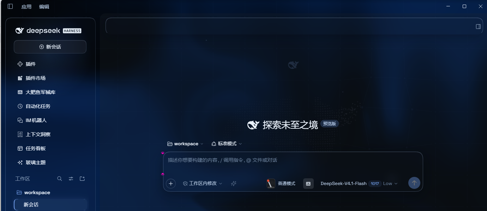
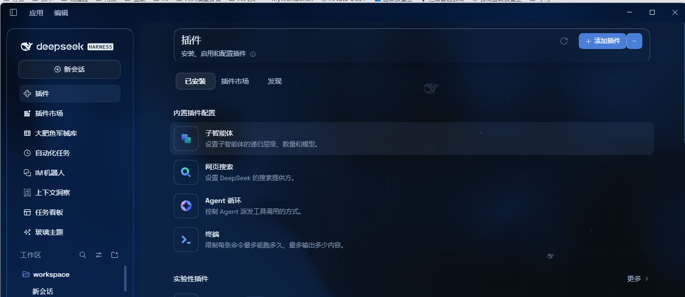
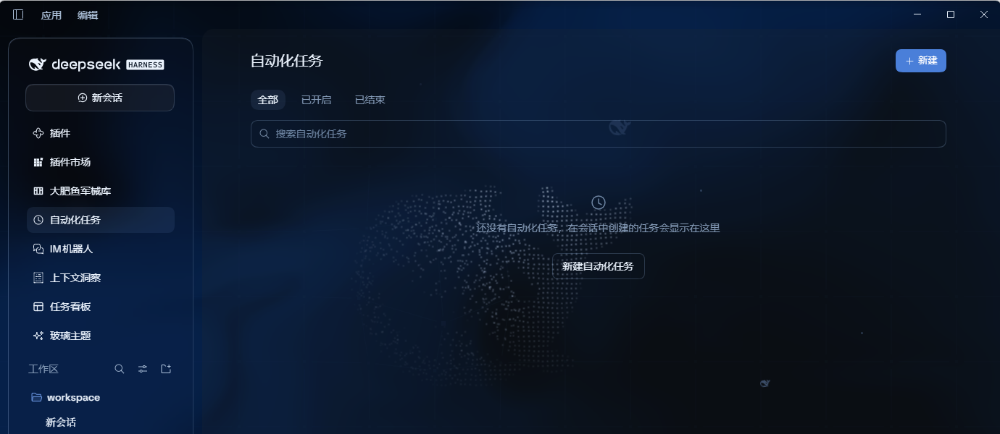
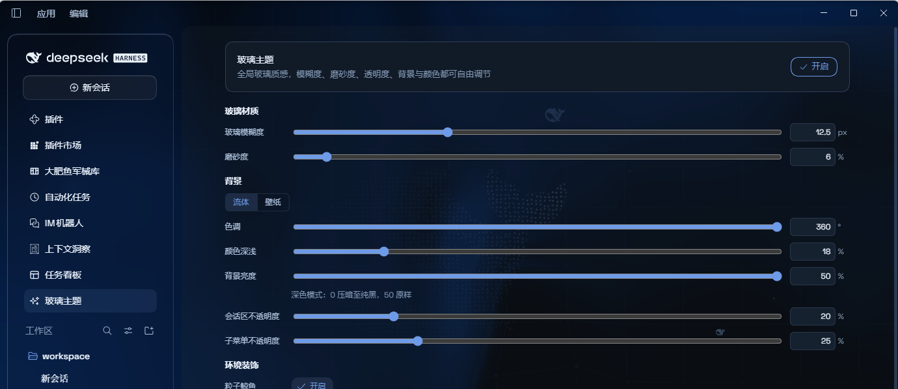

# Aqua 玻璃主题（社区维护版）

[English](README.md) | 中文

> **上游说明**：本包基于原作者 **WYH66666666** 的 [DSH-Transparent-UI-Plugin](https://github.com/WYH66666666/DSH-Transparent-UI-Plugin)（npm 上的 `dsh-client-ui-aqua`）**v1.3.0** 源码继续维护。原作者声明因学业繁忙无法及时适配 DSH 新 API，本版本在其基础上修复与适配，**不保证**与未来 DSH 版本兼容——升级 DSH 前请先备份 profile。

## 来源与致谢

| 项 | 内容 |
|---|---|
| 原作者 | **WYH66666666** — [仓库](https://github.com/WYH66666666/DSH-Transparent-UI-Plugin) |
| 上游 npm 包 | `dsh-client-ui-aqua`（最新 1.3.1） |
| 本包基线 | 上游 **v1.3.0** 源码 |
| 本包维护 | **ZHUBAI0528** — [仓库](https://github.com/ZHUBAI0528/dsh-client-ui-aqua) |
| 本包 npm 包名 | `@zhubai0528/dsh-client-ui-aqua` |
| 本包版本 | **2.0.0**（自该版本起独立演进） |
| 许可 | **AGPL-3.0**（沿用上游 `LICENSE`，原版权与许可声明完整保留） |

Aqua 是一层高自由度的玻璃质感主题，套在 DeepSeek Harness 网页端与桌面端。顶栏、输入框与状态栏、轨迹视图等区域成为磨砂玻璃片，主内容区背后可以是流体板，也可以是自定义壁纸（图片或视频）；侧边栏保持原生外观。关掉开关就回到原生界面，不改 DSH 任何一行源码。









## 与上游 v1.3.0 的差异

| 项 | 上游 v1.3.0 | 本包 v2.0.0 |
|---|---|---|
| 布局模式 | **云母 + 兼容** 双模式，可切换 | **仅云母**：兼容模式与其切换入口整体移除（含底层 token 与样式） |
| 边缘渐变模糊带 | 顶部/底部 5px 渐变模糊带（上游特性） | **已移除**：读取时会被误看成一层额外渐变wash；可读性改由主列 veil 承担（13px 极窄边缘淡出保留） |
| 子菜单不透明度 | 无该档位 | **新增**，默认 96%，与「会话区不透明度」同组 |
| 子菜单点击行为 | 悬停展开，随后点击会立刻收起 | **新增「点击保持展开」**：悬停展开后点击保持、再点收起；按 ARIA 契约逐级生效，键盘 Enter 不受影响 |
| 弹层材质 | 填充 `62% × 磨砂`（默认约 8.7%），易与正文叠字 | 填充 **96%** + `玻璃模糊度 + 4px`，面板不再透出后方文字 |
| 输入框与状态栏 | 两块玻璃，中间 6px 缝隙 | **合并为一块连续玻璃**（单一圆角、细线分隔） |
| 浅色模式会话区 | 列的 background 被宿主/皮肤插件覆盖时 veil 失效 → 整片白、会话区不透明度滑杆无效 | **已修复**：veil 用 `!important` 并同时匹配 `[class*='centerCol']`，不再依赖盖章时机 |
| 深浅模式切换 | 切到深色后背景不跟随，需手动重调参数 | **已修复**：监听 `body[data-ds-dark-theme]`，自动重算流体调色板、辉光色与亮度叠加方向 |
| 冷启动流体 | GPU 未就绪时流体永久不绘制（浅色下表现为整片白） | **已修复**：退避重试（最多 8 次，约 12s） |
| 发布包内容 | `files` 未含 `cordis.patch.yml`，安装后插件不加载 | **已修复**：tarball 含 `cordis.patch.yml` 与 `lib/*` |
| 依赖范围 | peer `^0.1.0-rc.5`（与 0.2.x 宿主不符） | `>=0.1.0-rc.5 <0.3.0`，同时接受 0.1.x 与 0.2.x 宿主 |
| 许可声明 | 仓库 `LICENSE` 为 AGPL-3.0，`package.json` 却写 MIT | **已对齐**：统一声明 AGPL-3.0，不再自相矛盾 |

## 特性（当前版本）

- **云母玻璃布局**：顶栏、输入框、状态栏、轨迹视图为悬浮玻璃，模糊度与磨砂度可调
- **背景自由**：流体板（色调、颜色深浅可调）或自定义壁纸，图片与视频都支持；壁纸可单独调节模糊度、磨砂度，视频另有亮度档
- **背景亮度**：自动跟随深浅模式——深色 0–50 压暗、浅色 50–100 提亮，50 原样
- **会话区不透明度**：0 让壁纸/流体原样透出，100 为不透明底板
- **子菜单不透明度**：弹层（菜单、下拉、快速调用面板）的填充强度，独立于卡片
- **子菜单交互 → 点击保持展开**：悬停展开的子菜单在被点击时保持展开，再点一次收起
- **环境装饰**：粒子鲸鱼（deepseek.com/harness 同款）、小鱼、网状交互，可分别开关
- **悬停效果 → 鼠标辉光**：指针附近的高光跟随
- **Harness 光泽铭牌**：深色模式侧边栏铭牌换成官网同款药丸，浅色保持原版
- **边缘淡出**：13px 极窄边缘淡出，内容滚到边缘自然融入
- 一键开关：关闭即完全还原原生界面，所有效果随插件卸载一并消失

## 安装

> 上游包 `dsh-client-ui-aqua` 与本包 `@zhubai0528/dsh-client-ui-aqua` **不要同时安装**，否则 profile 里会出现两个 `ui-aqua` 条目。

### 方式一：npm 一键安装（推荐）

```sh
dsh plugin --profile web add @zhubai0528/dsh-client-ui-aqua
```

从 npm 安装最新版，自动注册为 profile 插件层（`dsh.bundle` 补丁），所有平台通用。刷新界面即可生效。

### 方式二：GitHub 安装器（备用）

不需要 npm、不需要 git（自动退回 zip 下载）。

**Windows（一条命令）：**

```powershell
powershell -ExecutionPolicy Bypass -Command "Invoke-WebRequest 'https://github.com/ZHUBAI0528/dsh-client-ui-aqua/raw/main/install.ps1' -OutFile install.ps1; .\install.ps1"
```

默认安装**最新发布版**。脚本会把插件链接进 profile 的 `node_modules`，并在 `cordis.patch.yml` 里登记 `ui-aqua`（幂等，重复运行不会重复登记）。

### 方式三：手动（macOS / Linux）

```sh
git clone --depth 1 https://github.com/ZHUBAI0528/dsh-client-ui-aqua.git
ln -s "$PWD/dsh-client-ui-aqua" "$DSH_HOME/profiles/web/node_modules/@zhubai0528/dsh-client-ui-aqua"
```

然后往 `$DSH_HOME/profiles/web/cordis.patch.yml` 追加：

```yaml
- insert:
    - id: ui-aqua
      name: '@zhubai0528/dsh-client-ui-aqua'
```

## 使用

刷新界面。Aqua **默认开启**，总开关在左侧边栏的 **玻璃主题** 页面顶部（它是独立页面，不在「插件/设置」标签里）。面板分组自上而下为：

`玻璃材质`（玻璃模糊度、磨砂度）→ `背景`（流体/壁纸、色调、颜色深浅、背景亮度、会话区不透明度、子菜单不透明度）→ `环境装饰`（粒子鲸鱼、小鱼、网状交互）→ `子菜单交互`（点击保持展开）→ `悬停效果`（鼠标辉光）

> 上游的「模式」分组（云母效果 / 兼容模式）在 2.0.0 已整体移除。

## 从上游 1.x 升级

- `dsh.ui-aqua.mode` 不再被读取：此前选过「兼容模式」的用户会直接落到云母布局（键值保留，不会被清除）
- 其余参数（模糊、磨砂、色调、深浅、亮度、会话区不透明度等）键名不变，会原样沿用
- 包名不同，升级前请先卸载旧包，避免同时登记两个 `ui-aqua`

## 本地开发

```sh
npm install
npm run bundle      # 构建 lib/（tsdown → 内联 CSS → ESM→CJS 兼容层）
npm run watch       # 监听构建
```

发布前用 `powershell -ExecutionPolicy Bypass -File .\publish.ps1 -DryRun` 检查 tarball 内容，去掉 `-DryRun` 即正式发布。

## 许可

[AGPL-3.0](LICENSE)，沿用上游许可。原作者的版权与许可声明完整保留。
