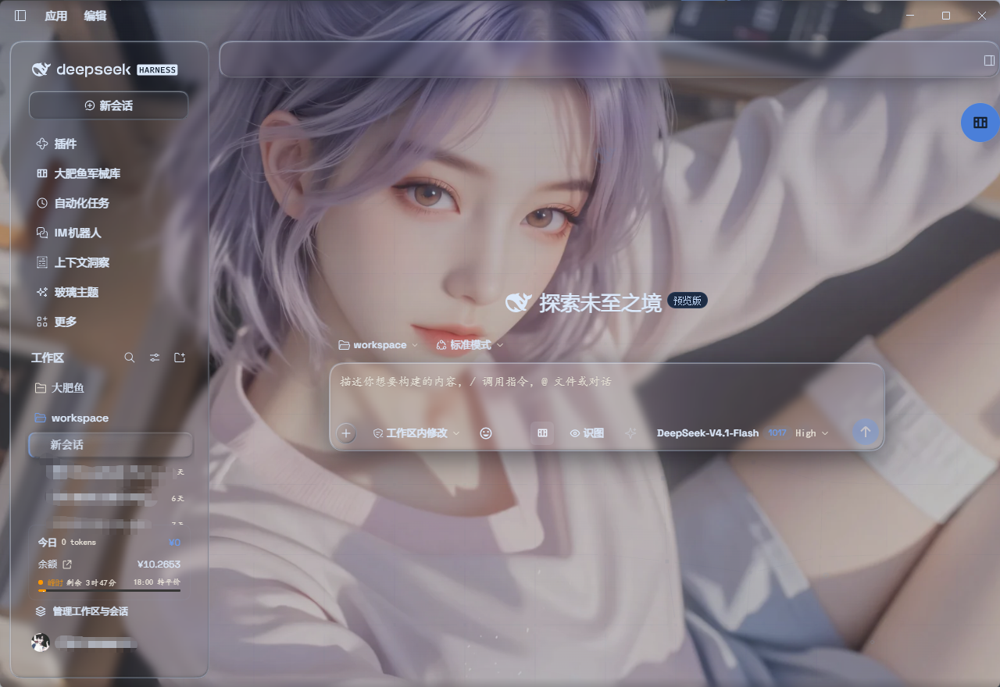
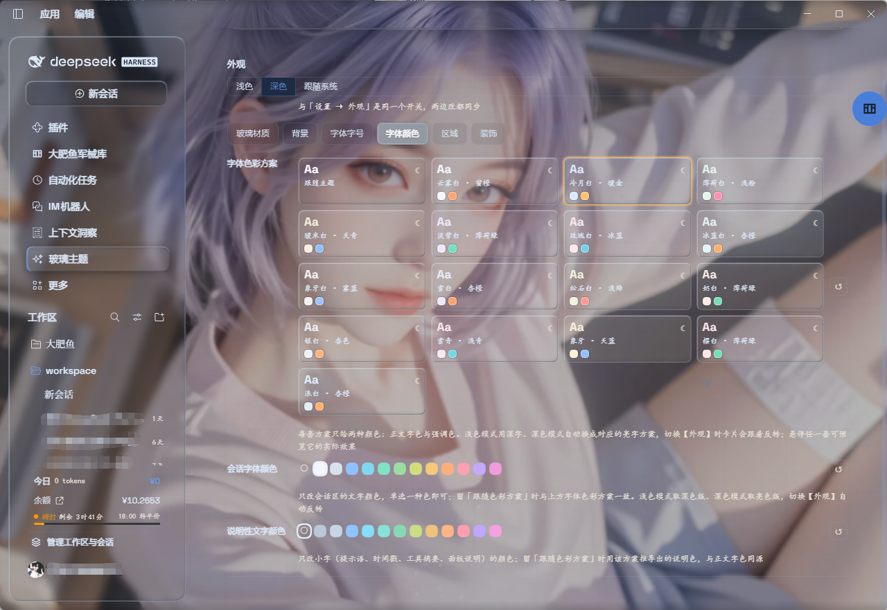
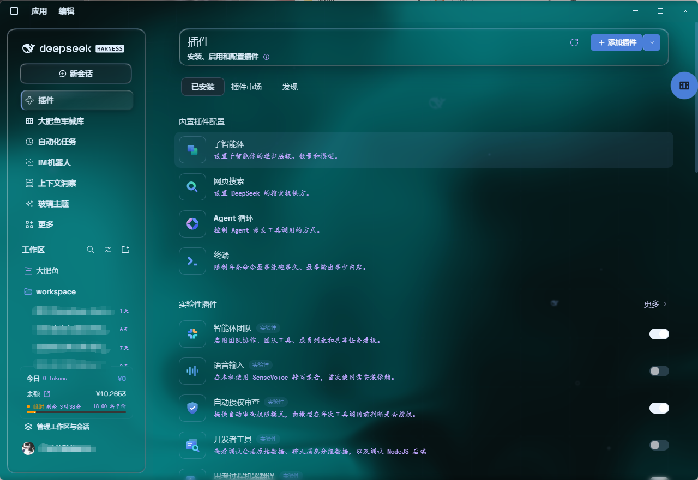
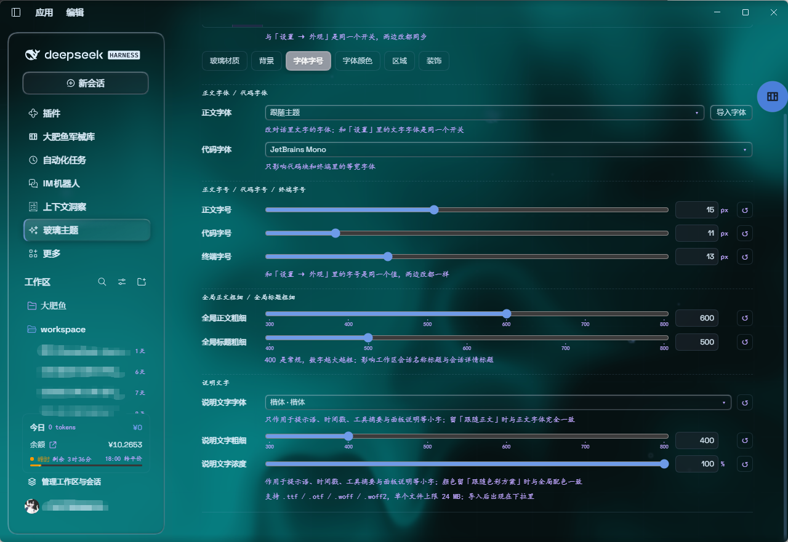

# Aqua 玻璃主题（社区维护版）

[English](README.md) | 中文

> **上游说明**：本包基于原作者 **WYH66666666** 的 [DSH-Transparent-UI-Plugin](https://github.com/WYH66666666/DSH-Transparent-UI-Plugin)（npm 上的 `dsh-client-ui-aqua`）**v1.3.0** 源码继续维护。原作者声明因学业繁忙无法及时适配 DSH 新 API，本版本在其基础上修复与适配，**不保证**与未来 DSH 版本兼容——升级 DSH 前请先备份 profile。

## 支持的 DSH 版本

| 项 | 内容 |
|---|---|
| **DSH 桌面端 / 网页端** | **0.2.x 整条版本线** |
| 宿主客户端包 | `@deepseek-ai/dsh-client-*` **0.2.x** |
| 元数据声明 | `package.json` → `engines.dsh: ">=0.2.1-0 <0.3.0"` |

适配按**大版本线**声明，不再钉某一个 rc 号：`-0` 后缀让任意预发布版本都算在内，所以 0.2.1 的各个 rc 与正式补丁都能装。主题依赖的挂载点（页头标记、输入区与统计栏接缝、插槽名）属于宿主内部客户端接口，跨 0.3 时需要重新核对，因此范围上限仍锁在 `<0.3.0`；升级到大版本前请保留 profile 备份。

## 标签与社区收录

仓库已打上 `dsh-plugin` 标签，会出现在 [dsh-plugin 社区主题页](https://github.com/topics/dsh-plugin)，与其它 DeepSeek Harness 插件并列。

`dsh-plugin` · `dsh` · `deepseek-harness` · `deepseek-harness-plugin` · `theme` · `glassmorphism` · `aqua`

## 来源与致谢

| 项 | 内容 |
|---|---|
| 原作者 | **WYH66666666** — [仓库](https://github.com/WYH66666666/DSH-Transparent-UI-Plugin) |
| 上游 npm 包 | `dsh-client-ui-aqua`（最新 1.3.1） |
| 本包基线 | 上游 **v1.3.0** 源码 |
| 本包维护 | **ZHUBAI0528** — [仓库](https://github.com/ZHUBAI0528/dsh-client-ui-aqua-community-fix) |
| 本包 npm 包名 | `@zhubai0528/dsh-client-ui-aqua-community-fix` |
| 本包版本 | **2.0.5** |
| **DSH 支持版本** | **>=0.2.1-0 <0.3.0** |
| 许可 | **AGPL-3.0**（沿用上游 `LICENSE`，原版权与许可声明完整保留） |

Aqua 是一层高自由度的玻璃质感主题，套在 DeepSeek Harness 网页端与桌面端。顶栏、输入框与状态栏、轨迹视图等区域成为磨砂玻璃片，主内容区背后可以是流体板，也可以是自定义壁纸（图片或视频）；侧边栏保持原生外观。关掉开关就回到原生界面，不改 DSH 任何一行源码。









## 与上游 v1.3.0 的差异

| 项 | 上游 v1.3.0 | 本包 v2.0.5 |
|---|---|---|
| 布局模式 | **云母 + 兼容** 双模式，可切换 | **仅云母**：兼容模式与其切换入口整体移除（含底层 token 与样式） |
| 边缘渐变模糊带 | 顶部/底部 5px 渐变模糊带（上游特性） | **已移除**：读取时会被误看成一层额外渐变wash；可读性改由主列 veil 承担（13px 极窄边缘淡出保留） |
| 子菜单不透明度 | 无该档位 | **新增**，默认 96%，与会话区底板薄纱同为填充档 |
| 子菜单点击行为 | 悬停展开，随后点击会立刻收起 | **新增「点击保持展开」**：悬停展开后点击保持、再点收起；按 ARIA 契约逐级生效，键盘 Enter 不受影响 |
| 弹层材质 | 填充 `62% × 磨砂`（默认约 8.7%），易与正文叠字 | 填充 **96%** + `玻璃模糊度 + 4px`，面板不再透出后方文字 |
| 输入框与状态栏 | 两块玻璃，中间 6px 缝隙 | **合并为一块连续玻璃**（单一圆角、细线分隔） |
| 浅色模式会话区 | 列的 background 被宿主/皮肤插件覆盖时 veil 失效 → 整片白、会话区不透明度滑杆无效 | **已修复**：veil 用 `!important` 并同时匹配 `[class*='centerCol']`，不再依赖盖章时机 |
| 深浅模式切换 | 切到深色后背景不跟随，需手动重调参数 | **已修复**：监听 `body[data-ds-dark-theme]`，自动重算流体调色板、辉光色与亮度叠加方向 |
| 冷启动流体 | GPU 未就绪时流体永久不绘制（浅色下表现为整片白） | **已修复**：退避重试（最多 8 次，约 12s） |
| 发布包内容 | `files` 未含 `cordis.patch.yml`，安装后插件不加载 | **已修复**：tarball 含 `cordis.patch.yml` 与 `lib/*` |
| 依赖范围 | peer `^0.1.0-rc.5`（与 0.2.x 宿主不符） | `>=0.2.1-rc.3 <0.3.0`，与本主题所依据的宿主版本线绑定 |
| 许可声明 | 仓库 `LICENSE` 为 AGPL-3.0，`package.json` 却写 MIT | **已对齐**：统一声明 AGPL-3.0，不再自相矛盾 |

## 特性（当前版本）

- **云母玻璃布局**：顶栏、输入框、状态栏、轨迹视图为悬浮玻璃，模糊度与磨砂度可调
- **主题控制面板**：颜色、壁纸、不透明度、模糊度等参数集中在一页，不必各处翻找
- **输入框取消 3D 效果**：3D 立体效果已移除，避免影响字体显示
- **字体可换**：正文、代码、说明文字各有独立的字体下拉，内置系统 / 开源 / 免费商用预设，也可导入本地 `.ttf`、`.otf`、`.woff`、`.woff2`（单个 ≤ 24 MB，存在浏览器 IndexedDB 里，重装不丢）
- **字号与字重**：三处字号（正文 / 代码 / 终端）、正文与标题字重、说明文字的字体 / 字重 / 浓度都能单独调；字重滑块标出全部离散档位
- **背景自由**：流体板（色调、颜色深浅可调）或自定义壁纸，图片与视频都支持；壁纸可单独调节模糊度、磨砂度，视频另有亮度档
- **跟随桌面端深浅模式**：自动适配桌面端浅色/深色切换，同步重算调色板、辉光与亮度方向
- **背景亮度**：自动跟随深浅模式——深色 0–50 压暗、浅色 50–100 提亮，50 原样
- **会话详情 / 菜单页两档模糊度**：分别管打开会话记录、从左侧菜单打开页面这两种界面，按侧边栏状态自动二选一
- **子菜单不透明度**：弹层（菜单、下拉、快速调用面板）的填充强度，独立于卡片
- **子菜单显示优化**：弹层填充提升至 96% 并叠加模糊，多级菜单始终清晰浮于正文之上
- **子菜单交互 → 点击保持展开**：悬停展开的子菜单在被点击时保持展开，再点一次收起
- **环境装饰**：粒子鲸鱼（deepseek.com/harness 同款）、小鱼、网状交互，可分别开关
- **悬停效果 → 鼠标辉光**：指针附近的高光跟随
- **Harness 光泽铭牌**：深色模式侧边栏铭牌换成官网同款药丸，浅色保持原版
- **边缘淡出**：13px 极窄边缘淡出，内容滚到边缘自然融入
- 一键开关：关闭即完全还原原生界面，所有效果随插件卸载一并消失

## 安装

> 上游包 `dsh-client-ui-aqua` 与本包 `@zhubai0528/dsh-client-ui-aqua-community-fix` **不要同时安装**，否则 profile 里会出现两个 `ui-aqua` 条目。

### 方式一：桌面版 — 应用内插件页安装（推荐）

打开 **DeepSeek Harness**，点击左侧栏的 **插件**。

点击 **添加插件**，在「包名或地址」中填入：

```
@zhubai0528/dsh-client-ui-aqua-community-fix
```

插件会从npm取用最新发布版。装完刷新界面即可生效。

### 方式二：一键脚本（Windows）

脚本**默认就从 npm 安装**，等同于方式三，只是省去手敲命令，并先把历史遗留的 junction 清掉。

```powershell
powershell -ExecutionPolicy Bypass -Command "Invoke-WebRequest 'https://github.com/ZHUBAI0528/dsh-client-ui-aqua-community-fix/raw/main/install.ps1' -OutFile install.ps1; .\install.ps1"
```

可选参数：

| 参数 | 说明 |
|---|---|
| `-Profile desktop` | 目标 profile（默认 `web`） |
| `-Version v2.0.5` | 固定版本（默认取 npm 上的 `latest`，会先查 registry 再 pin，避免 pnpm 的 `minimumReleaseAge` 让你装到旧版） |
| `-DshHome <路径>` | DSH 主目录（默认 `%USERPROFILE%\.dsh`） |
| `-Link` | **仅开发调试用**，见下 |

流程：定位 `dsh` CLI → 删掉两个 profile 位置里遗留的 junction → `dsh plugin --profile <名字> add <包[@版本]>`。

**`-Link` 只给开发调试用**：下载源码、按 `SHA256SUMS.txt` 校验 `lib/client.js`、在该 profile 的 `node_modules` 建 junction 指向源码，并登记 `cordis.patch.yml`。

> ⚠️ **日常安装不要用 `-Link`。** junction 会让应用的文件操作直接作用到源码目录 —— 应用卸载或回滚这个「已安装的包」时，删的是源码里的文件（本仓库就因此丢过 `.git/HEAD`、`.git/config`、`.git/index`）。而且它会阻止之后任何 npm 安装：
>
> ```
> [ERR_PNPM_EPERM] [importPackage ...] rename ... EPERM: operation not permitted
> ```
>
> pnpm 要把新解包的目录 rename 覆盖目标，而目标是跨卷重解析点，NTFS 不允许。改回 npm 只需**不带 `-Link` 再跑一次**，脚本会自动删链接（只删链接，不碰源码）。
>
> 手工删也行，但绝不能用递归删除（旧版工具会跟进目标目录把源码删掉）：
>
> ```powershell
> cmd /c rmdir "%USERPROFILE%\.dsh\profiles\desktop\node_modules\@zhubai0528\dsh-client-ui-aqua-community-fix"
> ```

### 方式三：npm

```sh
dsh plugin --profile web add @zhubai0528/dsh-client-ui-aqua-community-fix
```

从 npm 安装最新版，自动注册为 profile 插件层（`dsh.bundle` 补丁），所有平台通用。刷新界面即可生效。

包的 npm 页面：<https://www.npmjs.com/package/@zhubai0528/dsh-client-ui-aqua-community-fix>

> 需要本机已装 Node.js 与 npm。若访问 npm 官方源较慢，可临时指定镜像安装；注意镜像的同步有延迟，刚发布的版本可能尚未同步。

### 方式四：手动（macOS / Linux）

```sh
git clone --depth 1 https://github.com/ZHUBAI0528/dsh-client-ui-aqua-community-fix.git
ln -s "$PWD/dsh-client-ui-aqua-community-fix" "$DSH_HOME/profiles/web/node_modules/@zhubai0528/dsh-client-ui-aqua-community-fix"
```

然后往 `$DSH_HOME/profiles/web/cordis.patch.yml` 追加：

```yaml
- insert:
    - id: ui-aqua
      name: '@zhubai0528/dsh-client-ui-aqua-community-fix'
```

## 使用

刷新界面。Aqua **默认开启**，总开关在左侧边栏的 **玻璃主题** 页面顶部（它是独立页面，不在「插件/设置」标签里）。

面板顶部是标签切换，一个标签一页：

| 标签 | 内容 |
|---|---|
| `玻璃材质` | 玻璃模糊度、磨砂度 |
| `背景` | 流体 / 壁纸、色调、颜色深浅、背景亮度、会话详情模糊度、菜单页模糊度、子菜单不透明度 |
| `字体字号` | 三类字体来源、三类字号、正文 / 标题字重、说明文字字重与浓度 |
| `字体颜色` | 字体色彩方案（每套两色，随外观反转）、会话字体颜色（纯色）、说明文字全局选色 |
| `区域` | 侧边栏 / 页头 / 会话区 / 输入区四区的字重与说明文字微调、行高、重置本区 |
| `装饰` | 粒子鲸鱼、小鱼、网状交互、鼠标辉光、子菜单点击保持展开 |

所有玻璃面共用一套**边缘配方**：沿外沿的 1 px 亮边、受光角的提亮与对角的阴影（合起来读作玻璃厚度）、以及上下边缘各一道柔和的折射晕 —— 浅色模式偏冷白，深色模式改用更暗的亮边加冷蓝折射，边缘不会像画上去的白框。

标签选择会被记住：切去别的侧边栏页再回来、甚至重启 DSH，都停在上次那一页（设置键 `dsh.ui-aqua.panelTab`）；想回到默认就从「背景」重新点一次。

> 上游的「模式」分组（云母效果 / 兼容模式）在 2.0.0 已整体移除。

## 背景与视觉调节

背景有流体、壁纸和视频三种来源，由设置面板顶部的分段控件切换，**默认流体**。所有数值项统一为「滑块 + 数字输入框」双联动：拖动即时生效，数字框可直接键入精确值，越界自动收敛到边界；设置持久化在本地，刷新后保留。

**流体板（默认）** 是实时流动的渐变，由两个旋钮控制：「色调」0–360° 定色相（默认 320°，偏紫红），「颜色深浅」0–100% 定浓度（默认 25%）。

**图片壁纸与视频壁纸** 用「选择图片」「选择视频」上传。任一按钮选定文件后，背景来源会**自动切换到壁纸**，不必再手动拨分段控件。图片接受浏览器可解码的常见格式（PNG、JPG、WebP 等）；视频接受 MP4、WebM、Ogg、QuickTime。已有壁纸时面板出现「删除壁纸」，用于清空回纯流体。

两类壁纸的可调项不同：图片壁纸可调「壁纸模糊度」与「壁纸磨砂度」；视频壁纸可调「视频模糊度」与「视频亮度」——视频没有独立的磨砂层，改由亮度配合自动压暗来保证可读性。

### 参数一览

| 设置项 | 适用 | 范围 | 步进 | 默认 |
|---|---|---|---|---|
| 背景来源 | 全部 | 流体 / 壁纸 | — | 流体 |
| 色调 | 流体 | 0–360° | 1° | 320° |
| 颜色深浅 | 流体 | 0–100% | 1% | 25% |
| 壁纸模糊度 | 图片 | 0–40 px | 0.5 px | 0 |
| 壁纸磨砂度 | 图片 | 0–100% | 1% | 0 |
| 视频模糊度 | 视频 | 0–40 px | 0.5 px | 6 px |
| 视频亮度 | 视频 | 0–100% | 1% | 45% |
| 玻璃模糊度 | 全部 | 0–40 px | 0.5 px | 20 px |
| 会话详情模糊度 | 全部 | 0–40 px | 0.5 px | 14 px |
| 菜单页模糊度 | 全部 | 0–40 px | 0.5 px | 14 px |
| 磨砂度 | 全部 | 0–100% | 1% | 7% |
| 背景亮度 | 全部 | 深色 0–50 / 浅色 50–100 | 1% | 50 |
| 子菜单不透明度 | 全部 | 0–100% | 1% | 96% |

「背景亮度」的取值范围随明暗模式自动切换：深色模式只开放 0–50（0 压至纯黑，50 原样），浅色模式只开放 50–100（50 原样，100 提亮至纯白）；另一半区间不可达，所以两个模式下的选择互不影响。

「子菜单不透明度」单独一档，因为弹层浮在正文与输入框文字之上，需要比卡片更实的底色。会话区底板本身仍有一层薄纱（内部值 25%，不再单独提供旋钮）—— 两个模糊度旋钮已经决定背景透出多少。

会话区有两档模糊度，按**左侧边栏的状态**二选一，同一时刻只有一个生效：打开会话记录时用「会话详情模糊度」，从左侧菜单打开页面（设置页、插件 / 定时任务等功能页）时用「菜单页模糊度」——设置页自身的磨砂也归后者管，所以待在设置页里拖这个滑块就能立刻看到变化。

「玻璃模糊度」除玻璃材质本身，还会按比例缩放会话列那层可读玻璃（基准 20 px = 1.0，0 = 全清，40 = 两倍）。原因在实现里：整列只有一层背景模糊，列内的顶栏卡片、输入框、气泡都无法再叠加自己的模糊，所以材质旋钮必须作用在这层上，调它才会连同会话顶栏、菜单详情页顶栏和输入框一起变化。

### 使用须知

1. **视频会被自动压暗** —— 为保证前景文字清晰，视频壁纸默认叠加压暗且不可关闭，但可用「视频亮度」「视频模糊度」在此基础上前调。
2. **刷新后视频可能不自动播放** —— 浏览器对本地视频重放有授权限制；此时再点一次「选择视频」即可恢复，无需重新选文件。
3. **壁纸要与明暗模式匹配** —— 浅色壁纸配浅色模式、深色壁纸配深色模式，否则文字对比度会下降；面板内已就此提示。

## 字体与排版

「字体字号」标签页管三件事：字体来源、字号、字重，每条设置下方的注释直接说明它作用于哪里。「字体颜色」与「区域」是另外两个标签，前者定正文字色与说明文字选色，后者逐区域微调。

**字体色彩方案**四列排列，每套只给两种颜色（正文字色 + 强调色），名字也按这两色取 —— 浅色显示「墨黑 · 朱橙」、深色显示「云雾白 · 蜜橙」，卡片标签与色点因此始终对得上。切换「外观」时卡片、名字与正文一起反转；选中框用该方案自己的强调色描边，不再借用桌面端预置的蓝色主色。悬停任一方案会弹出说明，移开即消失。**会话字体颜色**是纯色单选，只改会话区的文字；**说明性文字颜色**共十三档，跟随色彩方案时会自动取该方案的说明色。

**字体来源**：正文、代码、说明文字各有独立的字体下拉，默认「跟随主题」。内置预设分三类：系统字体（微软雅黑、等线、中易黑体、宋体、楷体、Consolas、Cascadia Code）、开源（思源黑体 / 思源宋体、霞鹜文楷、更纱黑体 Mono、JetBrains Mono）、免费商用（MiSans、HarmonyOS Sans）。预设只是一串 `font-family` 候选，**系统真装了才生效**，否则逐级回落到后备字体。

**导入自己的字体**：点「导入字体」选本地文件，支持 `.ttf`、`.otf`、`.woff`、`.woff2`，单个上限 **24 MB**（超出会明确报错，不会静默失败）。`.ttc` 字体集合不接受——`@font-face` 无法寻址集合里的单个字重。文件存进浏览器的 IndexedDB，关掉 DSH 也不丢；导入后会实际加载一次验证，失败如实提示，不会先弹「导入成功」。导入成功即出现在三个下拉里，并自动选中为正文。

下拉中每项右侧的 × 可删除，删除前会确认；若该字体正被使用，删除会同时把相关设置退回「跟随主题」，不留指向已删字体的空引用。同名家族重复导入会复用已有记录，不会出现两个永远选不中的重复项。

**字重滑块是分档的**：300–800 之间只有 6 个档位（步进 100），滑块下方标出全部档位数字，不是连续滑动。

| 设置项 | 范围 | 步进 | 默认 |
|---|---|---|---|
| 正文字号 | 10–22 px | 1 px | 14 px |
| 代码字号 | 10–16 px | 1 px | 11 px |
| 终端字号 | 10–20 px | 1 px | 13 px |
| 正文粗细 | 300–800 | 100（6 档，带刻度） | 400 |
| 标题粗细 | 400–800 | 100（5 档，带刻度） | 600 |
| 说明文字粗细 | 300–800 | 100（6 档，带刻度） | 400 |
| 说明文字浓度 | 40–100% | 5% | 全局 80% / 区域 92% |
| 行高 | 1–2.5 | 0.05 | 1.5 |

说明文字浓度虽按 5% 步进，但一路平滑变淡、观感连续，所以不标刻度；只有字重那种「跳一档明显不同」的滑块才标。

设置分两层：字号由宿主主题服务管理（与「设置 → 外观」里的字号是同一份，两边改了互相同步），字体与字重由本插件保存。

## 故障排查

### 插件页的开关点了没反应，或提示「被更高优先级配置覆盖」

**症状**：在插件页或插件市场里开关 Aqua 没有效果，市场日志反复出现
`-> off: fiber=true`；但主题本身是好的，界面正常。

**原因**：Aqua 是 bundle 类插件，它的加载行只写在包内的 `cordis.patch.yml` 里。
DSH 要能启用/禁用某个插件，还需要 profile 自己的 `cordis.patch.yml` 里有一条**同 id**
的行作为 patch 目标。没有这条，宿主把该条目判为 `unaddressable`——插件照常运行，
但开关既写不进去，也关不掉。

**修复**：在 profile 的 `cordis.patch.yml` 末尾加三行（Windows 默认在
`%USERPROFILE%\.dsh\profiles\<profile>\cordis.patch.yml`）：

```yaml
- id: ui-aqua
  name: '@zhubai0528/dsh-client-ui-aqua-community-fix'
  disabled: false
```

`name` 必须是**包名**（不能写成 `ui-aqua`），否则宿主仍判为不可寻址。加完重启生效。

重跑一次 `install.ps1` 也会自动补上这行（幂等，已存在则跳过）。
装插件前如果在插件页批量禁用过所有插件，升级 DSH 后最容易遇到这种情况。

## 从上游 1.x 升级

- `dsh.ui-aqua.mode` 不再被读取：此前选过「兼容模式」的用户会直接落到云母布局（键值保留，不会被清除）
- 其余参数（模糊、磨砂、色调、深浅、亮度等）键名不变，会原样沿用
- 2.0.5 起会话字体颜色改用新键 `dsh.ui-aqua.chatColor`（纯色），旧键 `paletteChat` 不再读取
- 包名不同，升级前请先卸载旧包，避免同时登记两个 `ui-aqua`

## 本地开发

```sh
npm install
npm run bundle      # 构建 lib/（tsdown → 内联 CSS → ESM→CJS 兼容层）
npm run watch       # 监听构建
```

发布前用 `powershell -ExecutionPolicy Bypass -File .\publish.ps1 -DryRun` 检查 tarball 内容，去掉 `-DryRun` 即正式发布。

## 许可

[AGPL-3.0](LICENSE)，沿用上游许可。原作者的版权与许可声明完整保留。
